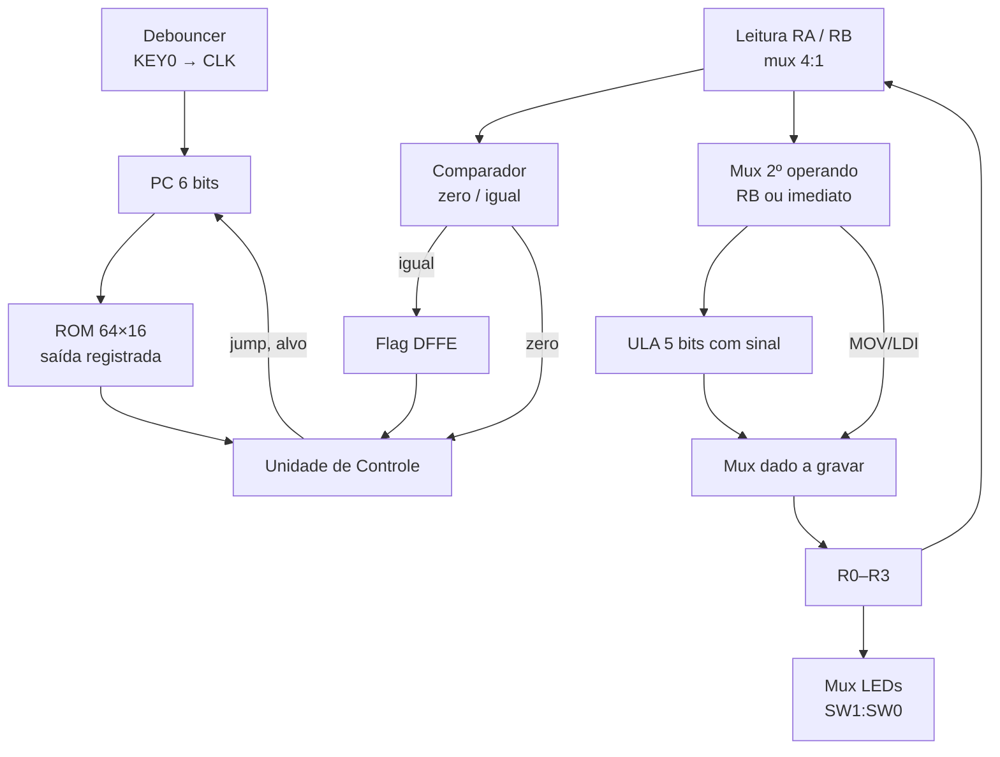

# Micro-CPU de 5 bits — DE0-CV

Processador simples de 5 bits com sinal, desenhado em esquemáticos (BDF) no **Quartus Prime 24.1** e sintetizado na placa **Terasic DE0-CV** (Cyclone V `5CEBA4F23C7`).

A CPU executa instruções de 16 bits a partir de uma ROM de 64 palavras, avança **uma instrução por clique** no botão `KEY0` e mostra o conteúdo de um dos 4 registradores nos LEDs `LEDR4..0`.

## Características

- **Dados:** 5 bits em complemento de 2 (−16 a +15)
- **Registradores:** 4 de uso geral (`R0`–`R3`)
- **Memória de programa:** ROM 64 × 16 bits, carregada de `proj.mif`
- **Instruções:** 12, codificadas com campos de bits fixos (a UC é quase só fios)
- **Pipeline:** 2 estágios (busca e execução), com *delay slot* após saltos
- **Clock:** manual, pelo `KEY0` com debouncer de ≈ 1,3 ms
- **Ferramentas:** montador (assembly → `.mif`) e simulador em nível de portas, ambos em Python

## Conjunto de instruções

| Instrução | Hex base | Efeito | Escreve? |
|---|---|---|---|
| `ADD Rd, Ra, Rb/#imm` | `0000` | Rd ← Ra + B | sim |
| `SUB Rd, Ra, Rb/#imm` | `2000` | Rd ← Ra − B | sim |
| `MUL Rd, Ra, Rb/#imm` | `4000` | Rd ← Ra × B (5 bits de baixo) | sim |
| `DIV Rd, Ra, Rb/#imm` | `6000` | Rd ← Ra ÷ B (inteira; 0 se B = 0) | sim |
| `MOV Rd, Rs` | `8000` | Rd ← Rs | sim |
| `LDI Rd, #imm` | `9000` | Rd ← imm | sim |
| `NOP` | `A000` | nada | não |
| `JMP alvo` | `A008` | PC ← alvo | não |
| `JZ Rx, alvo` | `A00C` | se Rx = 0, PC ← alvo | não |
| `RESET` | `B000` | zera PC, registradores e flag | não |
| `CMP Ra, Rb` | `E000` | flag ← (Ra = Rb) | não |
| `JE alvo` | `E00C` | se flag = 1, PC ← alvo | não |

Na forma com imediato, as instruções da ULA somam `1000` ao hex base (bit 12 = 1).

### Formato da instrução (16 bits)

| Bits | Campo | Significado |
|---|---|---|
| 15 | classe | 0 = ULA; 1 = demais instruções |
| 14..13 | sel_ula | ULA: `00` ADD, `01` SUB, `10` MUL, `11` DIV. Demais: bit 13 = 1 desliga a escrita; bit 14 = 1 escolhe a condição "igual" |
| 12 | use_reg2 | 1 = 2º operando é o imediato; 0 = é o registrador B |
| 11..10 | reg1 | Registrador A (1º operando, registrador testado no JZ, 1º do CMP) |
| 9..5 | reg2_imm | Imediato com sinal, registrador B (bits 6..5) ou bits 4..0 do alvo |
| 4 | res_jump | Bit 5 do alvo do salto |
| 3 | salto | 1 = instrução de salto |
| 2 | condicional | 1 = salto condicional (JZ/JE) |
| 1..0 | reg3 | Registrador de destino |

Exemplos:

| Assembly | Hex |
|---|---|
| `ADD R0, R1, R2` | `0440` |
| `ADD R0, R0, #-1` | `13E0` |
| `LDI R1, #6` | `90C1` |
| `JMP 0x0C` | `A188` |
| `JZ R1, 0x1A` | `A74C` |
| `CMP R1, R2` | `E440` |
| `JE 0x17` | `E2EC` |

## Arquitetura



Sinais de controle relevantes da UC (combinacional):

- `Write = NAND(b15, b13)`
- `Reset = b15 · b13 · b12`
- `cmp = b15 · b14 · b13 · ¬b12 · ¬b3`
- `jump = b3 · (¬b2 + ¬b14 · zero + b14 · igual)`

### Temporização

A ROM tem saída registrada no mesmo clock do PC e dos registradores, o que cria um pipeline de 2 estágios:

- A instrução do endereço **N** age no clique **N + 2** (o clique 1 executa `0000` = `ADD R0,R0,R0`, sem efeito).
- **Delay slot:** a instrução logo após um salto sempre executa.
- `RESET` zera registradores e flag imediatamente (clear assíncrono) e o PC na borda seguinte; a instrução após o `RESET` também executa.

## Interface com a placa

| Pino | Recurso | Sinal | Função |
|---|---|---|---|
| `PIN_M9` | CLOCK_50 | `clk` | Clock do debouncer |
| `PIN_U7` | KEY0 | `inb` | Clock manual (avança ao **soltar**) |
| `PIN_U13` | SW0 | `S[0]` | Seleção do registrador exibido |
| `PIN_V13` | SW1 | `S[1]` | Seleção do registrador exibido |
| `PIN_AA2` | LEDR0 | `D[0]` | Bit 0 |
| `PIN_AA1` | LEDR1 | `D[1]` | Bit 1 |
| `PIN_W2` | LEDR2 | `D[2]` | Bit 2 |
| `PIN_Y3` | LEDR3 | `D[3]` | Bit 3 |
| `PIN_N2` | LEDR4 | `D[4]` | Bit 4 (sinal) |

`SW1:SW0` = `00` → R0, `01` → R1, `10` → R2, `11` → R3.

## Estrutura do repositório

```
.
├── proj.bdf               # topo do projeto
├── reg.bdf                # registrador de 5 bits (5× DFFE)
├── uc.bdf / uc.bsf        # unidade de controle
├── contador.v             # PC de 6 bits
├── debouncer.v            # filtro do KEY0
├── mux2_5.v               # mux 2:1 de 5 bits
├── comparador_5bits.v     # sinais zero e igual
├── ula_5bits.vhd          # ULA com sinal
├── proj.mif               # programa carregado na ROM
├── proj.qsf               # configuração e pinagem
├── montador.py            # assembly → .mif
├── simular.py             # simulador clique a clique
└── programas/
    ├── teste_15.asm
    ├── teste_curto.asm
    └── proj.asm
```

## Como usar

### Montar e simular um programa

```bash
python3 montador.py programas/teste_15.asm proj.mif
python3 simular.py proj.mif 30
```

O montador aceita rótulos, `.org` e imediatos de −16 a 15, preenche o restante da ROM com `NOP` e comenta cada linha do `.mif`. O simulador reproduz a UC porta a porta, a ROM registrada, o delay slot e o RESET assíncrono, imprimindo PC, R0–R3, flag e saltos a cada clique.

### Gravar na placa

1. Copie o `proj.mif` gerado para a pasta do projeto.
2. No Quartus, recompile (**Processing → Start Compilation** ou `Ctrl+L`) — a ROM só lê o `.mif` na compilação.
3. Abra o **Programmer** e grave o `.sof`.
4. Com `SW1 = SW0 = 0`, compare cada clique com a saída do simulador.

> **Atenção:** não use *Update Symbol* no bloco `uc`. O `uc.bsf` foi editado à mão e o Quartus reorganiza as portas, desconectando os fios.

## Programas de teste

| Programa | Tamanho | O que cobre | Resultado esperado em R0 |
|---|---|---|---|
| `teste_15.asm` | 15 palavras | Instruções básicas e saltos tomados | `01111` parado |
| `teste_curto.asm` | 30 palavras | Saltos tomados e não tomados, termina com RESET | `01111`, depois reinicia |
| `proj.asm` | completo | Todas as instruções nas duas formas, R0–R3 | trocar `SW1:SW0` durante a execução |

Os programas usam `LDI R0, #-1` (`11111`) logo após saltos que devem ser tomados: se `11111` aparecer nos LEDs, um salto falhou.

## Limitações conhecidas

- Até 64 instruções; sem memória de dados, pilha ou sub-rotinas.
- Sem flag de overflow: `15 + 1 = −16` e `MUL` mantém só os 5 bits de baixo.
- O delay slot precisa ser considerado pelo programador.
- O RESET é combinacional e assíncrono nos registradores: há risco teórico de *glitch* em transições de instrução (não observado na placa). A correção robusta seria registrar o `RST` ou tornar o reset síncrono.

## Nota de depuração

O defeito principal do desenvolvimento foi um fio com **dois rótulos** no `proj.bdf`. O Quartus resolveu o fio por um só nome, deixou o outro net sem fonte e o ligou a GND — o 2º operando ficava sempre em 0, sem erro de compilação (apenas um warning). A correção foi substituir os `LPM_MUX` 2:1 com barramentos 2-D pelo `mux2_5.v` e adotar a regra **um nome por fio**.

## Documentação

O relatório completo (arquitetura, UC porta a porta, temporização e depuração) está em `docs/relatorio.pdf`.

## Autores

<!-- Preencha com os nomes e a disciplina/instituição -->
